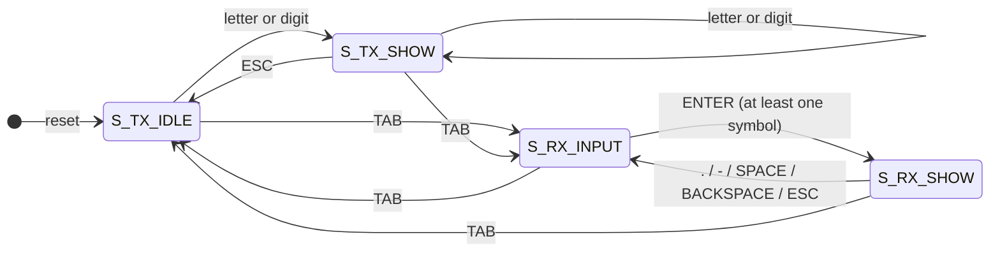
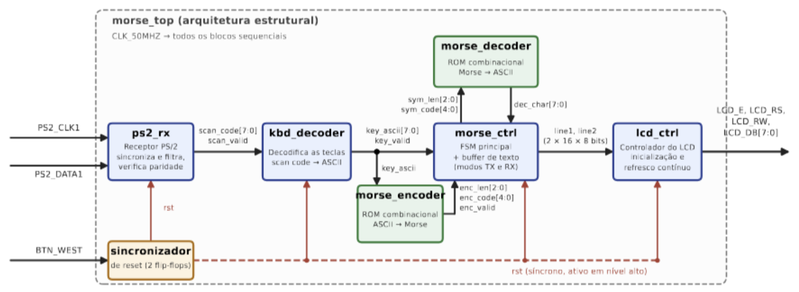

# Morse Code Translator on an FPGA

FPGA implementation of a bidirectional Morse code translator, with text input from a PS/2 keyboard and output on a 2×16 character LCD.

**Equipment:** Xilinx Spartan-3A/3AN Starter Kit (FPGA XC3S700AN-FGG484), PS/2 keyboard.

---

## Table of Contents

1. [Overview](#1-overview)
2. [Specification](#2-specification)
3. [State Machines](#3-state-machines)
4. [Architecture](#4-architecture)
5. [Design Details](#5-design-details)
6. [Keyboard and Display Interfaces](#6-keyboard-and-display-interfaces)
7. [Repository structure](#7-repository-structure)
8. [Implementation (Xilinx ISE 14.7)](#8-implementation-xilinx-ise-147)
9. [Simulation and Results](#9-simulation-and-results)
10. [References](#10-references)
11. [Authors](#11-authors)

---

## 1. Overview

This repository contains the VHDL description, testbenches and pin assignments of a bidirectional Morse code translator implemented on an FPGA. These files are intended to be synthesized and implemented in Xilinx ISE 14.7 and programmed on the Xilinx Spartan-3A/3AN Starter Kit (FPGA XC3S700AN-FGG484).

The user interacts with the system only through the PS/2 keyboard and the LCD. The system operates in two modes, toggled with the **TAB** key:

- **TX (text → Morse):** each letter or digit typed is added to the text on line 1 of the LCD, and its Morse code is shown on line 2.
- **RX (Morse → text):** dots and dashes are typed and confirmed with **ENTER**. The decoded character, or `?` for an invalid sequence, is added to the text on line 1.

The **BTN_WEST** button resets the system. At power-up, the system starts in TX mode, with line 1 empty and the message `TX> digite texto` on line 2.

## 2. Specification

### 2.1 Supported characters

The translator covers the 26 letters (A–Z) and the 10 digits (0–9) of the International Morse Code, with up to 5 symbols per character.

### 2.2 Keyboard commands

| Key | TX mode | RX mode |
|---|---|---|
| Letters A–Z and digits 0–9 | add the character to the text and show its Morse code on line 2 | ignored |
| `.` (dot) | ignored | adds a dot to the sequence (up to 5 symbols) |
| `-` (dash) | ignored | adds a dash to the sequence |
| ENTER | ignored | decodes the sequence and adds the character to the text (`?` if invalid) |
| SPACE | adds a space | adds a space |
| BACKSPACE | erases the last character of the text | erases the last symbol typed; with no symbols, erases the last character of the text |
| TAB | switches to RX mode | switches to TX mode |
| ESC | clears the text and the sequence | clears the text and the sequence |
| Other keys | ignored | ignored |

Digits are accepted from both the main row and the numeric keypad. The `.` and `-` symbols and the ENTER key (including the extended code `E0 5A`) are also accepted from both areas. Key release codes (`F0`) and unused keys are discarded.

### 2.3 LCD layout

- **Line 1:** accumulated text, up to 16 characters. When the limit is reached, the text scrolls one position to the left for each new character.
- **Line 2:** current mode, Morse code and conversion result.

| State | Line 2 |
|---|---|
| `S_TX_IDLE` | `TX> digite texto` |
| `S_TX_SHOW` | `TX> A = .-` |
| `S_RX_INPUT` | `RX> .-._` (`_` is the cursor) |
| `S_RX_SHOW` | `RX> .-.   = R` |

### 2.4 Inputs and outputs

| Signal | Board component | Pin | Function |
|---|---|---|---|
| `CLK_50MHZ` | 50 MHz oscillator | E12 | system clock |
| `BTN_WEST` | BTN_WEST | U15 | reset |
| `PS2_CLK1` | PS/2 connector | W12 | keyboard clock |
| `PS2_DATA1` | PS/2 connector | V11 | keyboard data |
| `LCD_E` | character LCD | AB4 | enable; the LCD reads the bus on the falling edge |
| `LCD_RS` | character LCD | Y14 | 0 = command, 1 = data |
| `LCD_RW` | character LCD | W13 | fixed at 0 (write only) |
| `LCD_DB(7:0)` | character LCD | Y15, AB16, Y16, AA12, AB12, AB17, AB18, Y13 | data bus |

## 3. State Machines

The system has four finite state machines:

| FSM | Block | Function | States |
|---|---|---|---|
| Main | `morse_ctrl` | TX and RX modes and text editing | `S_TX_IDLE`, `S_TX_SHOW`, `S_RX_INPUT`, `S_RX_SHOW` |
| PS/2 receiver | `ps2_rx` | reception of the 11-bit serial frame | `S_IDLE`, `S_RECV`, `S_CHECK` |
| Key decoder | `kbd_decoder` | handling of the `F0` and `E0` prefixes | `S_NORMAL`, `S_BREAK`, `S_EXT`, `S_EXT_BREAK` |
| LCD controller | `lcd_ctrl` | timing of each write to the display | `S_POWERUP`, `S_SETUP`, `S_PULSE`, `S_WAIT` |

### 3.1 Main state machine (`morse_ctrl`)

Reset takes the machine to `S_TX_IDLE`. At each key event (`key_valid = 1`), the next state and the action on the text depend on the key received.



- **S_TX_IDLE:** TX mode with no character typed. Line 2 shows `TX> digite texto`.
- **S_TX_SHOW:** TX mode after a character. Line 2 shows the last character and its Morse code.
- **S_RX_INPUT:** RX mode, in which the dots and dashes of the sequence are entered. Line 2 shows the sequence followed by a cursor.
- **S_RX_SHOW:** RX mode after a decoding, showing the result of the conversion, for example `.-. = R`.

Keys not shown in the diagram keep the current state. ENTER has no effect in `S_RX_SHOW`.

## 4. Architecture

The top module `morse_top` has a structural description: it instantiates the functional blocks and connects their signals, with no logic of its own besides the reset synchronizer.

<p align="center">
  
</p>

| Block | Type | Description |
|---|---|---|
| `morse_pkg` | package | LCD line type, ASCII constants and the Morse code representation shared by all blocks |
| `ps2_rx` | sequential | PS/2 receiver: synchronization, noise filtering, falling edge detection and parity check |
| `kbd_decoder` | sequential | converts scan codes (set 2) into ASCII, discarding key releases |
| `morse_encoder` | combinational | ROM: ASCII character → Morse code |
| `morse_decoder` | combinational | ROM: Morse code → ASCII character (`?` for invalid sequences) |
| `morse_ctrl` | sequential | main FSM and text buffer; builds the two LCD lines |
| `lcd_ctrl` | sequential | LCD initialization and continuous refresh |
| `morse_top` | structural | top module and reset synchronizer |

## 5. Design Details

### 5.1 Interfaces between blocks

| Signal | Width | Source → Destination |
|---|---|---|
| `scan_code` / `scan_valid` | 8 bits / 1 bit | `ps2_rx` → `kbd_decoder` |
| `key_ascii` / `key_valid` | 8 bits / 1 bit | `kbd_decoder` → `morse_encoder`, `morse_ctrl` |
| `enc_len`, `enc_code`, `enc_valid` | 3, 5 and 1 bits | `morse_encoder` → `morse_ctrl` |
| `sym_len`, `sym_code` | 3 and 5 bits | `morse_ctrl` → `morse_decoder` |
| `dec_char` | 8 bits | `morse_decoder` → `morse_ctrl` |
| `line1`, `line2` | 16 × 8 bits each | `morse_ctrl` → `lcd_ctrl` |
| `rst` | 1 bit | reset synchronizer → 4 blocks |

### 5.2 Clock and reset

All sequential blocks operate with the 50 MHz clock of the board (`CLK_50MHZ`). `BTN_WEST` is asynchronous to the clock, so it passes through a two-flip-flop synchronizer before being distributed as `rst` (synchronous, active high) to `ps2_rx`, `kbd_decoder`, `morse_ctrl` and `lcd_ctrl`. The synchronizer starts at `"11"`, so the system is also reset after the FPGA configuration. `morse_encoder` and `morse_decoder` are purely combinational and use neither clock nor reset.

### 5.3 Morse code representation

All blocks use the representation defined in `morse_pkg`: a pair (`len`, `code`), where `len` (3 bits) is the number of symbols, from 1 to 5, and `code` (5 bits) stores the sequence with the first symbol in bit 4. A `0` represents a dot and a `1` represents a dash. For example, the letter A (`.-`) is represented by `len = 2` and `code = "01000"`.

### 5.4 Design decisions

- `kbd_decoder` translates the special keys (ENTER, BACKSPACE, TAB, ESC and SPACE) into ASCII control codes. The following blocks work only with ASCII, without depending on the details of the PS/2 protocol.
- The conversions between characters and Morse codes are separated from the state machine, in independent combinational ROMs, which allows them to be tested in isolation.
- The `error_o` output of `ps2_rx` is not used in `morse_top`: frames with parity or stop bit errors are simply discarded.

## 6. Keyboard and Display Interfaces

### 6.1 Keyboard

The PS/2 lines are open-collector, so the UCF file declares them with `LVCMOS33` and `PULLUP`, as recommended in the board manual (UG334). The system only receives data from the keyboard.

The keyboard generates its own clock (about 10 to 30 kHz) and sends each byte in an 11-bit frame: start bit, eight data bits (least significant first), odd parity bit and stop bit. Data is valid on the falling edge of the clock.

| Event | Bytes sent | Example |
|---|---|---|
| Key pressed | `<code>` | A: `1C` |
| Key released | `F0 <code>` | A: `F0 1C` |
| Extended key | `E0 <code>` | keypad ENTER: `E0 5A` |
| Key held down | `<code>` repeated about every 100 ms | – |

The keyboard clock never drives the internal logic of the FPGA; it is only sampled by the 50 MHz clock. Both PS/2 lines go through two-flip-flop synchronizers, a filter requires eight consecutive equal samples to accept a level change, and a detector identifies the falling edges. Incomplete frames are discarded after a 2 ms timeout. Since the keyboard controller already handles contact bounce, each press reaches the FPGA as a single scan code, except for the automatic repetition when a key is held down.

### 6.2 Display

The LCD has 2 lines of 16 columns and is based on the Sitronix ST7066U controller, compatible with the HD44780, used through its 8-bit interface. The system never reads the display: instead of polling the busy flag, the controller waits for the minimum times specified by the manufacturer.

**Initialization:** after an initial 20 ms wait, the controller sends, only once, three `0x30` commands (wake up), `0x38` (8-bit interface, 2 lines, 5×8 font), `0x06` (cursor increment), `0x0C` (display on, no cursor) and `0x01` (clear display).

**Writing:** each command or character goes through the states `S_SETUP` (80 ns), `S_PULSE` (320 ns) and `S_WAIT` (50 µs, or 2 ms after Clear). All times respect the manufacturer's minimums (40 ns, 230 ns and 40 µs, respectively). After initialization, the controller continuously repeats the address `0x80`, the 16 characters of line 1, the address `0xC0` and the 16 characters of line 2, refreshing the display about 600 times per second. Outputs are registered, and the bus is loaded only in the first cycle of `S_SETUP`, so that the data never changes close to the rising edge of `LCD_E`.

## 7. Repository structure

```
├── morse_pkg.vhd        # shared types, constants and functions
├── ps2_rx.vhd           # PS/2 receiver
├── kbd_decoder.vhd      # scan code → ASCII
├── morse_encoder.vhd    # ASCII → Morse
├── morse_decoder.vhd    # Morse → ASCII
├── morse_ctrl.vhd       # main FSM and text buffer
├── lcd_ctrl.vhd         # LCD controller
├── morse_top.vhd        # top module
├── morse_top.ucf        # pin assignments for the Spartan-3AN Starter Kit
├── block_diagram.png    # block diagram
├── tb_morse_codec.vhd   # testbench: encoder and decoder
├── tb_ps2_kbd.vhd       # testbench: PS/2 receiver and key decoder
├── tb_morse_top.vhd     # testbench: complete system
└── README.md
```

## 8. Implementation (Xilinx ISE 14.7)

1. Create a project with the following settings: Family = Spartan3A and Spartan3AN, Device = XC3S700AN, Package = FGG484, Speed = -4, Preferred Language = VHDL.
2. Add all design files (`morse_pkg.vhd` to `morse_top.vhd`) with association **All**, and set `morse_top` as the top module.
3. Add `morse_top.ucf` with association **Implementation**.
4. Run **Generate Programming File**.
5. Program the FPGA through iMPACT (Boundary Scan), assigning `morse_top.bit` to the XC3S700AN, keeping the XCF04S memory in bypass and using **Program FPGA Only**.

## 9. Simulation and Results

### 9.1 Simulation

The design was verified with three self-checking testbenches, organized hierarchically: first the Morse conversion tables, then the keyboard input interface and finally the complete system. In the testbenches, the LCD times and the PS/2 timeout are reduced through generics to speed up the simulation.

| Testbench | Unit under test | What is checked | Result |
|---|---|---|---|
| `tb_morse_codec` | `morse_encoder`, `morse_decoder` | round trip of the 36 characters; known codes (A, S, O, Q, 0, 5); all 62 sequences of 1 to 5 symbols (36 valid, 26 decoded as `?`); `len = 0` and `len = 6`; characters without Morse code | `0 error(s), 36 valid codes found` |
| `tb_ps2_kbd` | `ps2_rx`, `kbd_decoder` | key presses and releases, keypad ENTER, ignored keys, frame with inverted parity bit, recovery after an interrupted frame (expected: 7 key events and 1 discarded frame) | – |
| `tb_morse_top` | `morse_top` | complete system, with a keyboard model and an HD44780 LCD model that checks the initialization commands, the setup time, the `LCD_E` pulse width, `LCD_RW` and the text on both lines | `0 error(s), 0 LCD timing error(s)` |

To run a testbench in Xilinx ISE (ISim), add it with association **Simulation**, switch the *Design* panel view to **Simulation** and run **Simulate Behavioral Model**.

### 9.2 FPGA implementation

The implementation in ISE 14.7 (device `xc3s700an-4fgg484`) completed without errors: all signals were routed and all timing constraints were met.

| Resource | Used | Utilization |
|---|---|---|
| Flip-flops | 262 | 2% |
| LUTs | 951 | 8% |
| Slices | 521 | 8% |
| I/O pins | 15 | 4% |

The 15 I/O pins correspond exactly to the design signals: clock, reset, the two PS/2 lines and the eleven LCD lines. The synthesis warnings are expected: most of them (Xst:1293 and Xst:1896) report that bit 7 of the character registers is always 0, since all ASCII codes used are below 128, so the synthesizer removes these flip-flops. Warning Xst:753 reports that the `error_o` output of `ps2_rx` is not connected, which is intentional.

### 9.3 Tests on the board

| Test | Action | Expected result | Result |
|---|---|---|---|
| Initialization | power on the board | `TX> digite texto` on line 2 | as expected |
| TX | type SOS | `SOS` / `TX> S = ...` | as expected |
| RX | TAB, dot, dash, dot, ENTER | character R added to the text | as expected |
| Invalid sequence | dot, dash, dot, dash, ENTER | character `?` | as expected |
| Editing | BACKSPACE, SPACE, ESC | erase, insert a space and clear | as expected |
| Scrolling | type more than 16 characters | text shifted to the left | as expected |
| Reset | press BTN_WEST | return to the initial state | as expected |

## 10. References

1. BARBOSA, R. *Tutorial de como utilizar o ISE*. YouTube. Available at: <https://www.youtube.com/watch?v=c1qYBH4PqFc>.
2. FREIRE, E. de M. *VHDL Code for PS/2 USB Keyboard*. Pantech Solutions. Available at: <https://www.pantechsolutions.net/vhdl-code-for-ps-2-usb-keyboard>.
3. FREIRE, E. de M. *Tutorial de como utilizar o display LCD das placas de FPGA*. YouTube. Available at: <https://youtu.be/tbBiHPvzUIg>.
4. MOURA, G. *So how does a PS/2 keyboard interface work?* YouTube. Available at: <https://youtu.be/7aXbh9VUB3U>.
5. XILINX. *Spartan-3A/3AN FPGA Starter Kit Board User Guide*. UG334, Version 1.1, 2008. Available at: <https://docs.amd.com/v/u/en-US/ug334>.

## 11. Authors

| Name | GitHub |
|---|---|
| Bruna Garcia Barrientos Resende | [@BrunaBarr](https://github.com/BrunaBarr) |
| Júlia Teles Braga Sylvestre | [@juliateleseng](https://github.com/juliateleseng) |
